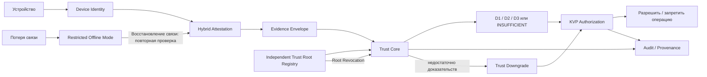

# NETCITY — DEVICE TRUST ATTESTATION SPECIFICATION

**Документ:** `docs/DEVICE_TRUST_ATTESTATION_SPEC.md`  
**Версия:** 0.1  
**Дата:** 24 ноября 2026  
**Статус:** TARGET / ARCHITECTURE PROPOSAL  
**Область:** Device Identity · Trust Core · Independent Trust Root Registry · KVP Authorization  
**Ветка документа:** `work/spatial-planner`

> Документ фиксирует согласованную целевую архитектуру Device Trust Attestation v0.1. Он не утверждает, что описанные компоненты, протоколы, аппаратная аттестация или процессы уже реализованы. Статус реализации устанавливается отдельно по исходному коду, конфигурации и результатам проверок.

---

## 1. Назначение

Device Trust Attestation определяет, как NetCity получает, проверяет и использует доказательства доверия к конкретному экземпляру устройства.

Цель — не присвоить устройству абстрактную метку «надёжное», а проверить ограниченные утверждения о его идентичности, защите ключей и состоянии целостности. Результат проверки передаётся в KVP как один из входов для отдельного решения о полномочиях.

**Основной принцип:**

`Device Identity ≠ Device Trust ≠ Authorization`

- **Device Identity** отвечает на вопрос: «Какой именно экземпляр устройства предъявляет себя системе?»
- **Trust Core** отвечает на вопрос: «Какие утверждения о защите и целостности устройства подтверждены проверяемыми доказательствами?»
- **KVP Authorization** отвечает на вопрос: «Разрешена ли этому субъекту конкретная операция в текущем контексте?»

Ни регистрация устройства, ни успешная аттестация, ни высокий уровень D3 сами по себе не дают разрешения на операцию.

## 2. Нормативные принципы

1. **Идентичность устройства индивидуальна.** Каждый физический экземпляр имеет собственную `device_id` и собственную криптографическую идентичность.
2. **Ключи не копируются между устройствами.** Компрометация одного device key не должна автоматически раскрывать ключи других устройств или Human Identity.
3. **Hybrid Trust.** Поддерживаются hardware-backed и software-based способы защиты. Отсутствие TPM / Secure Element не исключает устройство из системы, но может ограничивать уровень доверия и доступные операции.
4. **Доказательства важнее заявлений.** Уровень доверия определяется проверяемыми evidence, а не полями, которые устройство сообщает о себе.
5. **Аттестация имеет ограниченный смысл.** Каждое evidence подтверждает только явно сформулированное утверждение в пределах возможностей конкретной платформы.
6. **Freshness обязательна.** Старые доказательства не становятся свежими из-за повторной отправки или копирования.
7. **Проверки многоуровневые.** Первичная, периодическая, событийная аттестация и проверка перед критическими операциями дополняют друг друга.
8. **Недоступность проверки не равна компрометации.** При потере связи действует Restricted Offline Mode с ограничением операций.
9. **KVP — окончательный источник полномочий.** Trust Core предоставляет проверенный результат, но не выдаёт разрешения на бизнес- или системные операции.
10. **Независимость корней доверия.** Реестр доверенных корней не может единолично изменяться устройством, производителем, Architect, Planner или Agent Swarm.
11. **Отзыв имеет последствия для зависимых доказательств.** Компрометация или отзыв корня доверия запускает пересмотр результатов, опирающихся на него.
12. **Аудируемость.** Проверки, результаты, изменения уровней и решения KVP связываются через Audit / Provenance.
13. **Минимизация чувствительных данных.** Не следует сохранять сырые аппаратные измерения и секреты без необходимости; предпочтительны защищённые ссылки, хеши, метаданные и результаты проверки.
14. **Честное обозначение готовности.** TARGET / PROPOSED не представляется как IMPLEMENTED.

## 3. Место в архитектуре NetCity

### 3.1. Логический поток



Схема описывает целевую логическую архитектуру, а не существующий runtime-поток.

### 3.2. Границы ответственности

| Компонент | Ответственность | Не имеет права |
|---|---|---|
| Device Identity | Идентифицировать конкретный экземпляр устройства, управлять его ключевой идентичностью и регистрационным статусом | Самостоятельно назначать себе trust level или полномочия |
| Attestation Producer | Формировать evidence через доступные механизмы платформы | Самостоятельно объявлять evidence проверенным |
| Independent Trust Root Registry (TRR) | Предоставлять разрешённые корни, цепочки и статусы доверия | Единолично подменять решение KVP об операции |
| Trust Core | Проверять подписи, цепочки, freshness, binding и claims; формировать результат доверия | Выдавать ALLOW на прикладную операцию |
| KVP Authorization | Принимать решение по конкретной операции с учётом identity, policy, trust, scope и approval | Доверять только локальному статусу устройства или Planner snapshot |
| Audit / Provenance | Связывать evidence, версии политик, проверки, изменения trust и решения | Содержать открытые приватные ключи, токены или ненужные сырые секреты |
| Architect / Planner / Agent Swarm | Запрашивать операции и предоставлять контекст планирования | Изменять TRR, Trust Core policy или обходить KVP Gate |

TRR, Trust Core и KVP — разные логические контуры. Их можно развернуть в одной инфраструктуре только при сохранении проверяемой изоляции полномочий и управления.

## 4. Device Identity binding

### 4.1. Идентичность экземпляра

Каждый зарегистрированный экземпляр устройства получает:

- `device_id` — случайный стабильный идентификатор без персональных данных;
- собственную криптографическую пару ключей;
- сертификат или иное проверяемое удостоверение, связывающее публичный ключ с Device Identity;
- registration status;
- сведения о поддерживаемых механизмах защиты ключей;
- ссылки на актуальные trust evidence;
- собственные ограничения и полномочия, задаваемые KVP policy.

Приватный ключ не передаётся Trust Core, TRR, Architect или другому устройству. Подпись доказывает владение соответствующим ключом в пределах проверенной цепочки, но сама по себе не доказывает целостность ОС или runtime.

### 4.2. Связь с Human Identity

Один экземпляр устройства имеет одну Device Identity и может иметь несколько независимых Human Binding. Это не означает совместное использование активной сессии:

- каждый `binding_id` связывает конкретные `human_id` и `device_id`;
- каждое связывание подтверждается отдельно;
- одновременно допускается не более одного активного человеческого профиля/сессии на устройстве;
- переключение профиля требует завершения предыдущей сессии и отдельной аутентификации;
- данные, история, ключи и полномочия одного человека не передаются другому;
- отзыв одного Human Binding не отзывает остальные автоматически, если нет признаков компрометации самого устройства;
- отзыв Device Identity блокирует все привилегированные операции и сессии, основанные на ней.

### 4.3. Статусы Device Identity

| Статус | Значение |
|---|---|
| `UNREGISTERED` | Устройство ещё не зарегистрировано |
| `ENROLLING` | Выполняется регистрация и первичная проверка |
| `ACTIVE` | Идентичность зарегистрирована; дальнейшие операции всё равно требуют KVP Authorization |
| `DEGRADED` | Доказательства или состояние устройства ухудшились, но оснований для карантина может быть недостаточно |
| `QUARANTINED` | Привилегированные действия приостановлены из-за подозрения или нарушения заданных критериев |
| `REVOKED` | Идентичность устройства отозвана |

`REVOKED` не возвращается в `ACTIVE` простым снятием флага. Требуется новая регистрационная процедура с новыми ключами и проверками. Отзыв не удаляет Audit / Provenance.

## 5. Hybrid Attestation

### 5.1. Четыре режима запуска проверки

| Режим | Когда запускается | Цель |
|---|---|---|
| Первичная | Во время Device Enrollment | Проверить исходную идентичность, доступные механизмы защиты ключей и базовые evidence |
| Периодическая | По расписанию/интервалу, определённому risk policy | Обновлять актуальность evidence и обнаруживать изменения состояния |
| Событийная | При подозрительном событии, изменении конфигурации, смене ключа, обновлении или изменении trust state | Проверить последствия конкретного события |
| Перед критической операцией | Непосредственно перед операцией, когда policy требует свежего подтверждения | Убедиться, что evidence достаточно свежие и применимы к текущему контексту |

Полная аппаратная аттестация не должна выполняться каждую секунду. Между полными проверками система может проверять freshness и срок действия уже полученных evidence. Частота и глубина задаются policy риска, возможностями платформы и стоимостью проверки.

У каждого evidence собственный срок актуальности. Повторная передача старого evidence не продлевает его TTL.

### 5.2. Базовый цикл

1. Trust Core или уполномоченный verifier формирует уникальный challenge / nonce.
2. Challenge связывается с ожидаемым `device_id`, типом проверки и контекстом.
3. Устройство или поддерживаемый платформой attestation provider формирует ответ.
4. Ответ содержит claims и криптографическое доказательство происхождения.
5. Trust Core проверяет структуру, подпись, цепочку, назначение ключа, nonce, freshness, device binding и соответствие policy.
6. Trust Core формирует результат `VERIFIED`, `INSUFFICIENT` или `REJECTED`.
7. При достаточных доказательствах определяется максимально подтверждённый уровень D1/D2/D3.
8. Результат и ссылки на evidence передаются KVP для отдельной авторизации.
9. Проверка и решение фиксируются в Audit / Provenance.

Часы устройства не являются достаточным источником freshness. Используются nonce/challenge и проверяемые временные ограничения verifier-side. Защита от повторов и rollback должна быть предусмотрена протоколом.

## 6. Independent Trust Root Registry (TRR)

### 6.1. Назначение

TRR — независимый логический реестр доверенных корней и источников, на которые опирается проверка evidence. Он может содержать:

- разрешённые корневые сертификаты и промежуточные CA;
- идентификаторы производителей и attestation providers;
- допустимые профили и типы evidence;
- ограничения платформ, версий и назначений ключей;
- сроки действия и статусы отзыва;
- версии реестра и историю изменений;
- ссылки на опубликованные политики допустимости.

Производитель не может единолично объявить собственное устройство доверенным. Наличие сертификата от известного производителя не заменяет проверку конкретного claim и его соответствия policy.

### 6.2. Независимость и управление

TRR логически независим от Architect, Planner, Agent Swarm и Device Identity. Trust Core потребляет данные TRR и проверяет цепочки, но не должен единолично изменять список доверенных корней.

Критические изменения TRR выполняются по Dual Control:

1. человек утверждает критическое изменение;
2. независимый технический контур проверяет подпись, целостность, версию, происхождение, совместимость и допустимость;
3. только успешное прохождение обеих проверок позволяет применить изменение;
4. применение должно иметь контролируемый rollout и возможность безопасного rollback;
5. результат фиксируется в независимом Audit / Provenance.

Подпись подтверждает происхождение и целостность пакета, но не доказывает, что изменение безопасно или совместимо.

### 6.3. Trust Root Revocation

При подтверждённой компрометации, отзыве или недопустимости корня:

- TRR публикует новое состояние/версию с отзывом;
- Trust Core перестаёт принимать новые evidence, цепочка которых зависит от отозванного корня;
- выявляются ранее выданные результаты, зависимые от этого корня;
- такие результаты помечаются для пересмотра и не должны считаться актуальными автоматически;
- KVP применяет policy к затронутым устройствам и операциям: downgrade, restricted state, quarantine или deny — в зависимости от риска и доказательств;
- все зависимые решения и действия связываются в Audit / Provenance.

Отзыв корня не доказывает автоматически компрометацию каждого устройства, но отменяет возможность безусловно полагаться на evidence, чья цепочка больше не доверена.

## 7. Trust Core и уровни D1 / D2 / D3

### 7.1. Группы evidence

Trust Core оценивает пять групп доказательств:

1. **Identity Proof** — привязка публичного ключа и claims к конкретному `device_id`.
2. **Key Protection** — свойства хранения и использования приватного ключа.
3. **Hardware Evidence** — доказательства происхождения ключа и аппаратной защиты, если платформа их предоставляет.
4. **Boot Integrity** — измерения и проверяемые утверждения о цепочке загрузки.
5. **Runtime Integrity** — проверяемые утверждения о состоянии исполнения, если для платформы существует надёжный механизм.

Отсутствие одной группы не всегда означает отказ во всей идентичности. Оно ограничивает максимальный уровень, который можно обоснованно подтвердить.

### 7.2. Уровни доверия

| Уровень | Минимальный смысл | Ограничения |
|---|---|---|
| **D1 — Software** | Подтверждены Device Identity, владение ключом, подпись, freshness и базовая оценка доступной среды | Не заявляется аппаратная защита или проверенная цепочка загрузки |
| **D2 — Hardware-backed** | Дополнительно проверены аппаратное происхождение/защита ключа и цепочка доверия аппаратного модуля; non-exportability заявляется только если это действительно доказано платформой | Само наличие TPM / Secure Element не гарантирует D2 |
| **D3 — Attested** | Подтверждён D2 и дополнительно проверены применимые измерения загрузки и/или runtime claims относительно известной политики целостности | Не является абсолютным доказательством отсутствия компрометации и не даёт автоматический ALLOW |

Правила:
- Trust Core назначает только максимальный уровень, для которого имеются достаточные проверяемые evidence.
- D3 не присваивается только по факту наличия TPM.
- Если D3 не подтверждён, D2 или D1 могут быть назначены только при самостоятельной достаточности их evidence.
- Если не подтверждён даже D1, результат уровня — `INSUFFICIENT`.
- Software trust не наследует hardware trust автоматически.
- D1/D2/D3 — уровни доверия, а не роли, полномочия или пользовательские статусы.

### 7.3. Результат проверки

| Результат | Значение | Типичное дальнейшее действие |
|---|---|---|
| `VERIFIED` | Evidence корректны и достаточны для заявленного результата проверки | Зафиксировать подтверждённый уровень; передать его KVP как вход policy |
| `INSUFFICIENT` | Доказательств недостаточно, они устарели или платформа не поддерживает требуемый claim | Не повышать trust; применить downgrade/restricted policy или запросить повторную проверку |
| `REJECTED` | Evidence не прошло обязательную проверку: например, неверная подпись, нарушенная цепочка, несовпадение binding или некорректный challenge | Не принимать evidence; зафиксировать причину; при признаках подделки рассмотреть QUARANTINED |

`REJECTED` не означает автоматически, что владелец устройства виновен или что устройство доказанно скомпрометировано. Реакция зависит от причины, контекста и policy.

`VERIFIED` означает только то, что указанные claims прошли заданную проверку. Это не означает, что устройство безопасно во всех отношениях.

## 8. Trust Downgrade и Quarantine

### 8.1. Trust Downgrade

Основания могут включать:

- истечение TTL evidence;
- потерю доступа к требуемому источнику доказательств;
- изменение конфигурации, требующее повторной проверки;
- отзыв корня или промежуточного сертификата;
- несовпадение новых измерений с утверждённой политикой;
- невозможность подтвердить ранее заявленный уровень.

Trust Core пересматривает уровень на основании оставшихся валидных evidence. Возможные результаты: D3 → D2, D2 → D1, D1 → `INSUFFICIENT`. Нельзя сохранять высокий уровень только потому, что он был присвоен раньше.

KVP применяет последствия downgrade к каждой операции по действующей policy. Сам downgrade не должен незаметно менять Human Identity или другие Device Identity.

### 8.2. Quarantine

`QUARANTINED` — защитное состояние Device Identity, а не утверждение о виновности пользователя.

При выполнении заранее определённых критериев KVP может автоматически инициировать карантин без ожидания human approval. В зависимости от policy:

- блокируются привилегированные действия и доступ к чувствительным ресурсам;
- приостанавливаются или отзываются сессии и делегации, основанные на устройстве;
- сохраняются evidence и Audit / Provenance;
- другие устройства и независимые Human Binding продолжают работу, если не затронуты;
- восстановление требует проверки и нового решения KVP.

Критерии и переходы в карантин должны быть формализованы отдельной policy; этот документ не задаёт окончательные численные пороги.

## 9. Restricted Offline Mode

### 9.1. Принцип

Отсутствие связи с Trust Core само по себе не доказывает компрометацию. Однако устройство, не имеющее возможности проверить актуальное состояние отзыва и policy, не может гарантировать свежесть своих полномочий.

Поэтому временная недоступность проверки переводит выполнение в Restricted Offline Mode, а не в режим полного доверия.

### 9.2. Допустимое поведение

- разрешены только безопасные локальные функции, заранее разрешённые policy;
- локальные операции не должны требовать свежего удалённого подтверждения;
- привилегированные, критические и внешние операции блокируются, если им нужна актуальная проверка KVP;
- нельзя накапливать привилегированные команды для автоматического выполнения после восстановления связи;
- локальный кэш evidence не продлевает их TTL и не отменяет отзыв;
- Restricted Offline Mode не является автоматическим `QUARANTINED` и не обязан менять lifecycle status устройства.

### 9.3. Восстановление связи

После восстановления связи:

1. выполняется повторная проверка актуальности evidence и при необходимости новая аттестация;
2. Trust Core сверяет актуальный TRR и применимые версии policy;
3. KVP заново проверяет identity, status, capabilities, полномочия и approval;
4. старые привилегированные разрешения не возобновляются автоматически;
5. накопленные команды не исполняются автоматически;
6. результат и переход режима фиксируются в Audit / Provenance.

## 10. KVP Authorization integration

Trust Core не выдаёт прикладное разрешение. Он передаёт KVP проверяемый результат, связанный с конкретным устройством и ограниченный по времени.

Перед каждой привилегированной операцией KVP должен проверить как минимум:

- активность и отзыв Device Identity;
- актуальность Human Binding и сессии;
- текущий trust result и срок его действия;
- допустимость уровня D1/D2/D3 для конкретной операции;
- актуальную capability и её версию;
- principal, роль, scope и затрагиваемые слои;
- действующую policy version;
- необходимые approvals и их scope/срок;
- отсутствие блокирующего карантина или отзыва;
- свежесть статуса отзыва и доступность обязательных контрольных зависимостей.

Планировщик может использовать snapshot capabilities для построения детерминированного proposal, но KVP обязан перепроверять актуальную capability и полномочия непосредственно перед исполнением. Snapshot Planner не является доказательством текущей допустимости операции.

### 10.1. Матрица доверия — не матрица разрешений

Пример ниже иллюстрирует, как policy может задавать минимальный уровень. Это не окончательная матрица прав:

| Класс операции | Возможный минимум | Дополнительные условия |
|---|---|---|
| Безопасное локальное чтение | D1 или иной уровень по policy | Активная identity, scope, свежая сессия |
| Изменение локального состояния | D1/D2 по риску | KVP policy, идемпотентность/компенсация, approval при необходимости |
| Привилегированная операция | D2 или D3 по policy | Свежая проверка KVP, актуальная capability, обязательные approvals |
| Критическая внешняя операция | Уровень, установленный risk policy | Явное human approval, ограниченный scope и срок, актуальное evidence |
| Операция при недоступном KVP | Только заранее разрешённая безопасная локальная функция | Никакого отложенного автоматического исполнения привилегированных команд |

Даже D3 может получить DENY. Уровень доверия — необходимый вход policy, но не достаточное основание для ALLOW.

## 11. Evidence envelope — проект формата

Ниже приведён концептуальный формат для дальнейшего проектирования. Он не является утверждённой protobuf-схемой или существующим API.

```json
{
  "schema_version": "netcity.device-attestation.v0.1",
  "attestation_id": "att-example-001",
  "device_id": "device-random-id",
  "challenge": {
    "challenge_id": "challenge-example-001",
    "nonce": "verifier-generated-unique-value",
    "issued_at": "verifier-time",
    "expires_at": "verifier-time"
  },
  "evidence": [
    {
      "evidence_type": "key_protection",
      "evidence_version": "1",
      "issuer_ref": "trust-root-ref",
      "key_id": "device-attestation-key",
      "claim_refs": ["device-key-bound", "hardware-backed"],
      "issued_at": "provider-time",
      "expires_at": "policy-bounded-time",
      "payload_ref": "protected-evidence-reference",
      "payload_digest": "sha256:...",
      "signature": "detached-signature"
    }
  ],
  "verification": {
    "trust_result": "VERIFIED",
    "verified_level": "D2",
    "trr_version": "registry-version",
    "policy_version": "trust-policy-version",
    "verified_at": "verifier-time",
    "expires_at": "verifier-derived-expiry",
    "verification_signature": "verifier-signature"
  }
}
```

Требования к реализации формата:
- ограничивать размер envelope и каждого evidence до разбора;
- явно задавать алгоритмы, key purpose и допустимые профили;
- связывать подпись с canonical representation данных;
- проверять nonce, срок действия, device binding и цепочку;
- не принимать неизвестные критические поля или неподдерживаемые алгоритмы;
- хранить только необходимые данные, используя защищённые ссылки для чувствительных payload;
- версионировать schema, policy и trust roots независимо;
- обеспечивать защиту от replay и rollback.

## 12. Audit / Provenance

Для каждой значимой операции должны быть доступны ссылки на:

- `device_id` и при необходимости `binding_id`;
- `attestation_id` и `challenge_id`;
- типы и версии evidence;
- issuer / trust-root references;
- версию TRR и Trust Policy;
- результат `VERIFIED` / `INSUFFICIENT` / `REJECTED`;
- назначенный уровень D1/D2/D3 или причину отсутствия уровня;
- время проверки и срок актуальности;
- события downgrade, quarantine, root revocation и recovery;
- KVP authorization decision, reason code, policy version и approval reference;
- идентификатор команды и результат исполнения, если операция выполнялась.

Audit не должен содержать приватные ключи, recovery secrets, session tokens, сырые prompt/cache данные или неограниченные аппаратные дампы. Для больших evidence используются защищённые ссылки, digest и метаданные.

Требования к долговечности, независимости audit sink, retention и внешнему anchoring должны быть согласованы с общей KVP Audit Architecture.

## 13. Ошибки и fail-closed поведение

| Ситуация | Результат Trust Core | Поведение KVP |
|---|---|---|
| Истёк TTL evidence | `INSUFFICIENT` для требующего свежести claim | Запретить операцию, если policy требует свежий claim |
| Неизвестный trust root | `REJECTED` или `INSUFFICIENT` согласно профилю проверки | Не принимать неподтверждённый trust; deny для операций, требующих его |
| Подпись неверна | `REJECTED` | Не исполнять; зарегистрировать событие; оценить quarantine policy |
| Nonce повторён/не совпадает | `REJECTED` | Не исполнять |
| Нет связи с verifier | Проверка недоступна | Restricted Offline Mode |
| Evidence недостаточно для D3, но достаточно для D2 | `VERIFIED` на D2, если D2 claims валидны | Применить требования операции к D2 |
| TRR отозвал корень | Зависимые результаты подлежат пересмотру | Применить актуальную policy; не считать прежнее подтверждение безусловно действительным |
| Trust Core или обязательная policy недоступны | Нет нового положительного результата | Deny для операций, требующих актуальной проверки |

Ошибка verifier не должна превращаться в положительный результат по умолчанию.

## 14. Recovery и связь с Identity Lifecycle

Device Trust Attestation не заменяет Recovery Root и Recovery Route.

- Потеря одного устройства запускает отзыв или пересмотр его Device Identity, сессий, сертификатов и делегаций; Human Identity сохраняется.
- Потеря всех устройств запускает отдельный Recovery Route для Human Identity.
- Восстановление Human Identity не восстанавливает автоматически старые device keys, сессии, делегации или полномочия.
- Новое устройство создаёт собственные ключи и проходит Hybrid Enrollment и первичную аттестацию.
- После восстановления связи устройство проходит повторную проверку; старые разрешения не возобновляются автоматически.
- При подозрении на захват Human Identity применяются независимые recovery controls и KVP policy.

Recovery Protection Window остаётся отдельным проектным решением, параметры и длительность которого должны определяться risk policy.

## 15. Нефункциональные требования

1. **Криптография:** использовать поддерживаемые криптографические библиотеки и стандартные профили; не проектировать собственные алгоритмы.
2. **Изоляция ключей:** приватные ключи не экспортируются из аппаратного хранилища, когда платформа действительно гарантирует это свойство; для software keys явно указывается более слабая модель.
3. **Freshness:** nonce/challenge уникальны и одноразовы; TTL назначается verifier policy.
4. **Версионирование:** версии evidence schema, trust roots, trust policy и verifier независимы и явно записываются.
5. **Ограничение ресурсов:** bounded parsing, payload limits, timeouts и защита от повторных запросов.
6. **Наблюдаемость:** логировать reason codes и метаданные без утечки секретов.
7. **Совместимость:** платформенные профили должны явно указывать, какие claims реально поддерживаются.
8. **Надёжность:** недоступность обязательного verifier или policy не приводит к ALLOW для операций, требующих свежего trust.
9. **Проверяемость:** каждый trust claim должен иметь источник, verifier rule и тестовый сценарий.
10. **Безопасное обновление:** изменения TRR и Trust Policy проходят контролируемую проверку, Dual Control для критических изменений и процедуру rollback.

## 16. Угрозы и обязательные проверки

Минимальный threat set:

- replay старого attestation response;
- подмена `device_id` или перенос evidence на другое устройство;
- использование ключа не по назначению;
- компрометация промежуточного или корневого CA;
- откат версии TRR или Trust Policy;
- поддельные claims от software-only агента;
- истёкшее или отозванное evidence;
- downgrade attack на алгоритм или профиль;
- потеря связи сразу после отзыва устройства;
- попытка исполнить отложенную привилегированную команду после reconnect;
- компрометация устройства при формально валидной подписи;
- чрезмерное доверие к manufacturer-provided claims.

До production-ready статуса необходимы как минимум:
- unit tests на каждое правило валидации;
- replay / nonce / TTL tests;
- signature, chain, key-purpose и revocation tests;
- device-binding и cross-device substitution tests;
- downgrade и rollback tests;
- TRR update / Dual Control / recovery tests;
- offline / reconnect / revoked-while-offline tests;
- KVP integration tests на свежесть trust перед dispatch;
- quarantine transition tests;
- audit redaction и provenance consistency tests;
- fuzzing bounded evidence parser;
- platform-specific conformance tests и независимый security review.

## 17. Открытые вопросы — не заморожены в v0.1

Следующие параметры намеренно не фиксируются этим документом:

1. Конкретные платформенные профили: TPM 2.0, Secure Enclave, Android Keystore/KeyMint, Apple Secure Enclave и другие — с отдельной проверкой реальных гарантий.
2. Точные интервалы периодической аттестации и risk-based TTL.
3. Конкретные криптографические алгоритмы и форматы evidence для каждой платформы.
4. Bootstrap, ротация и аварийное восстановление корней TRR.
5. Численные критерии автоматического Quarantine и Trust Downgrade.
6. Точная матрица минимальных D-level для классов операций.
7. Формат и API evidence envelope / verifier result.
8. Независимое хранение и anchoring Audit / Provenance.
9. Политика поведения при частичной недоступности TRR, Trust Core или audit sink.
10. Конкретная процедура безопасного rollback обновлений TRR.

Эти вопросы должны решаться через отдельные ADR / спецификации и threat review, а не заполняться предположениями в реализации.

## 18. Критерии готовности спецификации к реализации

Перед началом реализации должны быть согласованы:

- платформенные evidence profiles и точные claims;
- trust root bootstrap / rotation / revocation procedure;
- canonical evidence schema и verifier contract;
- freshness, nonce и TTL policy;
- правила D1/D2/D3 и downgrade;
- поведение Restricted Offline Mode;
- KVP authorization inputs и обязательные freshness checks;
- Audit / Provenance schema и failure policy;
- threat model и тестовый план;
- границы реализации и безопасная стратегия rollout.

**Текущий статус:** архитектурная спецификация v0.1. Реализация не подразумевается и данным документом не подтверждается.

---

## 19. Связанные документы

- [Spatial Interpreter Specification](./SPATIAL_INTERPRETER_SPEC.md)
- [Authorization Model](./authorization-model.md)
- [Security Model](./security-model.md)
- [Attestation and Integrity Claims](./attestation-model.md)
- [KVP Architecture](./kvp-architecture.md)
- [Adapter Contract](./adapter-contract.md)
