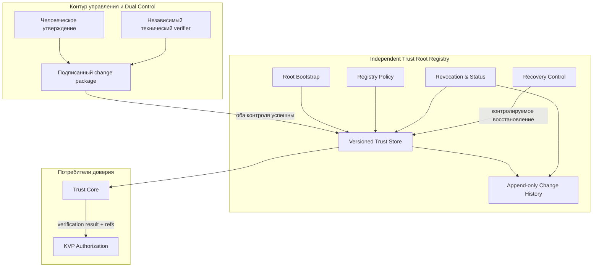

# NETCITY — TRUST ROOT REGISTRY SPECIFICATION

**Документ:** `docs/TRUST_ROOT_REGISTRY_SPEC.md`  
**Версия:** 0.1  
**Дата:** 24 ноября 2026  
**Статус:** TARGET / ARCHITECTURE PROPOSAL  
**Область:** Independent Trust Root Registry · Trust Core · KVP Authorization

> Это проектная спецификация. Она описывает целевую архитектуру и согласованные принципы, но не подтверждает наличие готового Registry service, root store, ceremony, ротации, отзыва или recovery implementation.

## 1. Назначение и фундаментальное разделение

Trust Root Registry (TRR) — независимый логический контур NetCity, который управляет перечнем корней и источников, допустимых для проверки криптографических доказательств доверия.

TRR отвечает на вопрос: **каким источникам и ключам разрешено выступать в качестве корней доверия для определённых типов утверждений, платформ и периодов времени?**

TRR не отвечает на вопрос, разрешена ли конкретная операция. Это остаётся ответственностью KVP Authorization.

`Trust Root Registry ≠ Trust Core ≠ KVP Authorization`

- **TRR** управляет доверенными корнями, их статусами, назначением, версиями и историей.
- **Trust Core** проверяет конкретные evidence относительно актуального состояния TRR и Trust Policy.
- **KVP** отдельно принимает решение по каждой операции с учётом identity, trust result, scope, capability, policy, approval и контекста.

Наличие root в реестре не означает, что все выданные им сертификаты, все устройства производителя или все claims автоматически доверены.

## 2. Согласованные архитектурные принципы

1. TRR логически независим от Architect, Planner, Agent Swarm, Digital Self и Device Identity.
2. Производитель устройства не может единолично добавлять собственный root или объявлять свои устройства доверенными.
3. Trust Core потребляет утверждённые данные TRR, но не обладает единоличным правом изменять trust anchors.
4. Критические изменения выполняются через Dual Control: человеческое утверждение плюс независимая техническая проверка.
5. Подпись пакета подтверждает происхождение и целостность, но не безопасность, совместимость или допустимость изменения.
6. Все изменения версионируются и имеют проверяемую историю.
7. Отзыв root влияет на все зависимые evidence и результаты, которые опираются на этот root.
8. Нельзя незаметно переписать историю доверия или откатить Registry на более старое состояние.
9. Недоступность актуального Registry не должна превращаться в положительное решение для операций, которым нужна свежая проверка.
10. TRR не хранит приватные ключи устройств, людей или производителей.
11. Восстановление TRR не должно зависеть от единственного online-ключа или одного администратора.
12. Любой статус root ограничен назначением, профилем, областью применения и сроком.

## 3. Логическая архитектура и границы доверия

Схема логическая. Физическое размещение сервисов и HSM/TPM ещё требует threat model и deployment design.

### 3.1. Компоненты

| Компонент | Ответственность | Запрещённая концентрация полномочий |
|---|---|---|
| Root Bootstrap | Начальная инициализация доверенного состояния TRR | Не должен быть обычной операцией приложения или действием агента |
| Trust Store | Версионированные root records и их metadata | Не принимает неподтверждённые записи |
| Registry Policy | Правила допустимости, назначения, сроков и переходов | Не может незаметно ослабляться через обычный update |
| Change Verifier | Проверка подписи, целостности, версии, происхождения и схемы change package | Не заменяет человеческое утверждение |
| Human Approval | Явное утверждение критического изменения человеком | Не может обойти техническую проверку |
| Revocation Controller | Публикация отзыва и запуск пересмотра зависимых claims | Не переписывает прошлые audit events |
| Change History / Audit | Append-only история изменений и доказательства принятия | Не должен быть доступен для редактирования обычным Registry writer |
| Recovery Control | Восстановление после утраты/компрометации управляющих факторов | Не является универсальным обходом Dual Control |

## 4. Root Record

Root record описывает публичный trust anchor и условия, при которых он может использоваться. Приватный ключ корня в TRR не помещается.

Проектные поля:

| Поле | Смысл |
|---|---|
| `root_id` | Стабильный случайный идентификатор записи |
| `root_type` | Тип корня: PKI CA, platform attestation root, manufacturer identity root или иной утверждённый тип |
| `public_key_or_certificate_ref` | Публичный ключ/сертификат либо защищённая ссылка на него |
| `fingerprint` | Криптографический fingerprint публичного материала |
| `issuer` | Происхождение и ответственная организация/платформа |
| `allowed_claims` | Точные типы claims, которые этот root вправе подтверждать |
| `platform_scope` | Поддерживаемые платформы, модели или профили |
| `key_usage` | Разрешённое назначение ключа |
| `valid_from`, `valid_until` | Период допустимости |
| `status` | Состояние root |
| `constraints` | Ограничения, алгоритмы, версии и дополнительные условия |
| `registry_version` | Версия TRR, в которой запись опубликована |
| `source_refs` | Ссылки на документы и доказательства происхождения |
| `created_event`, `last_change_event` | Ссылки на события истории |

Приватные ключи не хранятся в Root Record. Сертификат и fingerprint не являются достаточным основанием без проверки цепочки, назначения ключа, статуса и claim-specific policy.

### 4.1. Статусы root

- `PENDING` — заявлен, но не допущен к использованию.
- `ACTIVE` — разрешён в рамках конкретного scope и срока.
- `SUSPENDED` — временно не используется до выяснения обстоятельств.
- `REVOKED` — отозван; новые доказательства на его основе не принимаются.
- `EXPIRED` — срок допустимости истёк.
- `RETIRED` — выведен из активного использования контролируемым образом.

Переход из `REVOKED` обратно в `ACTIVE` запрещён. Если тот же оператор или производитель должен вернуться в доверенную систему, он проходит новую процедуру допуска с новым root identity и новой записью.

## 5. Root Bootstrap — первоначальная инициализация

Bootstrap — наиболее чувствительная операция TRR: она создаёт исходный набор доверенных anchors, от которого зависит проверка последующих изменений.

Целевые требования:

1. Bootstrap выполняется в отдельной контролируемой процедуре, вне обычного runtime потока Architect/Planner/Agent.
2. Источники публичных ключей и сертификатов проверяются независимо от заявителя.
3. Для каждого начального root фиксируются точный fingerprint, тип, issuer, назначение, scope, сроки и подтверждающие материалы.
4. Начальный Registry manifest получает уникальный идентификатор и монотонную версию.
5. Manifest подписывается выделенными ключами управления TRR, не ключами устройств и не ключами Agent Swarm.
6. Подписание требует Dual Control и фиксируется в независимом audit trail.
7. Проверяется возможность восстановления из резервной копии и независимой сверки fingerprint.
8. Первый manifest публикуется как immutable baseline; дальнейшие изменения оформляются отдельными change package.

**Открытый вопрос:** конкретная церемония bootstrap, число участников, схема резервных ключей и способ физической защиты root management keys должны быть определены отдельным ADR. Вариант 2-of-3 может быть рассмотрен, но не считается утверждённым решением.

## 6. Dual Control и Change Package

Любое добавление root, изменение его scope, замена публичного ключа, ослабление ограничений, изменение статуса и критическое изменение Registry Policy рассматривается как привилегированная операция.

### 6.1. Change Package

Проектная структура change package:

- `change_id`;
- `registry_id`;
- `base_registry_version`;
- `target_registry_version`;
- `change_type`;
- `root_id`;
- `proposed_record_digest`;
- `reason`;
- `source_refs`;
- `created_at`;
- `expires_at`;
- `human_approval_ref`;
- `technical_verification_ref`;
- `signatures`;
- `rollback_reference`, если применимо.

Change package должен быть однозначно связан с базовой версией TRR. Если базовая версия изменилась до применения пакета, пакет отклоняется и должен быть пересоздан/перепроверен.

### 6.2. Две независимые проверки

**Человеческая проверка:**
- кто утверждает;
- что именно меняется;
- почему изменение необходимо;
- какой root, scope и claims затрагиваются;
- срок действия и последствия;
- есть ли риск расширения доверия.

**Техническая проверка:**
- подписи и доверенные ключи управления;
- целостность и canonical digest;
- допустимость схемы и версии;
- base version и отсутствие rollback;
- происхождение материалов;
- совместимость алгоритмов и профилей;
- отсутствие запрещённых scope/claims;
- проверяемость перехода статуса;
- наличие audit/recovery материалов.

Обе проверки обязательны. Успех одной не компенсирует отказ другой. Технический verifier не является AI-агентом и не подчиняется Architect.

### 6.3. Применение изменения

1. Получить change package.
2. Проверить текущую версию Registry.
3. Проверить техническую подпись и содержимое.
4. Получить/проверить отдельное human approval.
5. Убедиться, что оба approvals относятся к одному digest и одному change_id.
6. Атомарно применить новую версию.
7. Зафиксировать change event в независимой истории.
8. Опубликовать новый manifest и контрольные fingerprints.
9. Уведомить Trust Core о новой версии.
10. Проверить, что потребители не используют устаревший snapshot для операций, требующих актуального Registry.

## 7. Rotation — плановая ротация

Ротация ключей и корней выполняется до истечения срока или при плановой смене криптографических материалов.

Требования:

- новая запись получает собственный root identity или явно версионированный key identity;
- новый публичный материал проверяется независимо;
- период перекрытия старого и нового root допускается только по policy и с чётким сроком;
- старый root не остаётся бессрочно ACTIVE «на всякий случай»;
- новые evidence постепенно переходят на новый root;
- Trust Core проверяет, каким root подписано конкретное evidence и в какой период;
- после окончания migration window старый root переводится в `RETIRED` или `EXPIRED`;
- все шаги и зависимые переходы фиксируются.

Ротация не должна создавать неоднозначность: для каждого evidence должно быть ясно, какой root был допустим в момент выдачи и остаётся ли это доказательство приемлемым сейчас.

## 8. Suspension и Revocation

### 8.1. Suspension

Используется при подозрении, когда требуется временно остановить использование root до расследования.

- новые evidence на его основе не должны приниматься для операций, требующих активного root;
- зависимые ранее выданные claims маркируются согласно policy;
- приостановка не стирает историю;
- снятие suspension требует нового change package и Dual Control.

### 8.2. Revocation

Причины:
- подтверждённая компрометация приватного ключа;
- компрометация CA или attestation provider;
- обнаруженная подделка/недопустимость корневой цепочки;
- нарушение условий допуска;
- ошибочная выдача root;
- криптографическая непригодность алгоритма или ключа.

Последовательность:

1. Создать revocation event с причиной, временем обнаружения и scope.
2. Проверить полномочия инициатора и применить emergency revocation policy, если ожидание Dual Control создаёт неприемлемый риск.
3. Опубликовать новую версию TRR с монотонно возрастающим номером.
4. Доставить событие потребителям и обеспечить проверку актуальной версии.
5. Trust Core строит dependency map: какие evidence, attestation results и trust decisions опирались на этот root.
6. Зависимые результаты переводятся на пересмотр; прежний `VERIFIED` не считается безусловно актуальным.
7. KVP повторно оценивает затронутые устройства и операции.
8. При необходимости инициируются Trust Downgrade, Restricted Mode, Quarantine или DENY по policy.
9. Событие и все последующие решения связываются в Audit / Provenance.

Emergency revocation не должна превращаться в общий обход Dual Control для добавления или расширения доверия. Её допустимый scope — немедленно ограничить/отозвать доверие по заранее определённым условиям. Последующая проверка и подтверждение выполняются независимо.

## 9. Rollback и anti-rollback

Rollback Registry не должен возвращать ранее отозванный root в активное состояние или отменять security event.

Различать:

- **Deployment rollback** — возврат программного релиза Registry к предыдущей проверенной версии.
- **Trust-state rollback** — возврат содержимого Registry к старой версии.

Первое может быть допустимо при сохранении актуального trust state и monotonic version. Второе запрещено, если оно отменяет отзыв, suspension, истечение срока или более новое security решение.

Обязательные механизмы:
- монотонная версия Registry;
- digest каждого manifest;
- подпись manifest;
- проверка base version при изменениях;
- внешний/независимый anchor последней принятой версии;
- отказ принимать manifest с меньшей версией;
- сверка после восстановления из резервной копии;
- audit reconciliation до допуска Registry к обслуживанию.

Технический способ хранения monotonic anchor и его защита — открытая тема реализации (например, защищённое аппаратное хранилище, независимый append-only сервис или иной механизм с отдельным threat review).

## 10. Registry Availability и Cached State

Trust Core может использовать локально кэшированную копию manifest только при проверке подписи, версии, срока свежести и отсутствия известного более нового обязательного security state.

Кэш не должен:
- продлевать срок root;
- отменять известный отзыв;
- уменьшать Registry version;
- служить источником ALLOW для операции, требующей online freshness, если актуальность не подтверждена.

При недоступности TRR:
- безопасные локальные функции могут продолжаться в заранее разрешённых пределах;
- операции, требующие актуального root status или свежей revocation information, блокируются;
- старые разрешения не накапливаются для последующего исполнения;
- после восстановления связи Trust Core сверяет актуальную версию и пересматривает зависимые результаты.

Отсутствие связи само по себе не переводит все устройства в QUARANTINED. Реакция определяется policy и характером последнего известного состояния.

## 11. Recovery of Registry Control

Восстановление управления TRR требуется при потере управляющих ключей, компрометации одного из факторов Dual Control, утрате Registry operator или повреждении хранилища.

Принципы:
- Recovery Control независим от Architect, Planner и Agent Swarm.
- Recovery credentials отделены от device keys, Human Identity root и обычных Registry signing keys.
- Восстановление не должно позволять одному лицу незаметно заменить весь trust base.
- После восстановления проводится сверка последней подтверждённой версии, независимых fingerprints и audit history.
- Все прежние управляющие ключи, признанные скомпрометированными, отзываются.
- Новые ключи управления создаются отдельно и проходят bootstrap/approval процедуру.
- До завершения восстановления критические изменения доверия блокируются; потребители используют только проверенное последнее состояние в пределах его policy freshness либо fail closed.

Порог резервных факторов (например, 2-of-3) не утверждён этой спецификацией. Схема восстановления, состав участников и физическое хранение recovery material требуют отдельного решения.

## 12. Связь с Trust Core

Trust Core получает:
- подписанный manifest TRR;
- версию и digest;
- root records и их scope;
- статусы ACTIVE/SUSPENDED/REVOKED/EXPIRED/RETIRED;
- policy references;
- revocation/change events;
- доказательства происхождения и актуальности.

Trust Core обязан:
1. проверить подпись manifest;
2. проверить монотонность версии и digest;
3. проверить допустимость источника Registry;
4. проверить статус root на момент выдачи evidence и на момент текущей проверки;
5. проверить claim scope и key usage;
6. учитывать revocation и suspension;
7. сформировать результат проверки с ссылкой на точную версию TRR;
8. не принимать неизвестный root или неподдерживаемый профиль;
9. передавать KVP не просто D-level, а также refs и срок актуальности результата.

Trust Core не имеет права самостоятельно добавлять root, менять root status или ослаблять Registry Policy.

## 13. Связь с KVP Authorization

KVP использует trust result как один из входов решения. Перед привилегированной операцией KVP проверяет:

- текущую Device Identity и её отзыв;
- актуальный trust result и его expiry;
- версию TRR, на которой основан результат;
- нет ли более нового revocation/suspension event;
- соответствует ли root конкретному claim и platform scope;
- минимальный trust level операции;
- текущую capability, principal, scope, затрагиваемые слои и policy;
- обязательные approvals и отсутствие карантина.

Если невозможно доказать актуальность критичного root status, KVP не должен выдавать ALLOW операции, требующей этого подтверждения.

Никакой статус root или trust level не создаёт полномочий автоматически.

## 14. Audit / Provenance

Каждое событие TRR должно включать как минимум:

- `registry_id`;
- `registry_version`;
- `previous_version`;
- `manifest_digest`;
- `change_id`;
- `root_id`;
- тип изменения;
- причину и scope;
- ссылки на source evidence;
- human approval reference;
- technical verification reference;
- время принятия и применения;
- identity управляющих субъектов;
- итоговый статус;
- связанные revocation/review events.

Нельзя записывать приватные ключи, recovery secrets и иные секреты. Audit должен быть защищён от изменения обычным Registry writer и по возможности храниться независимо от основного Registry store.

## 15. Минимальная модель угроз

TRR должен противостоять как минимум следующим сценариям:

- несанкционированное добавление нового root;
- подмена публичного ключа при сохранении прежнего root_id;
- replay старого change package;
- применение пакета к другой base version;
- rollback к manifest до отзыва;
- компрометация одного из двух факторов Dual Control;
- злоумышленный/скомпрометированный производитель;
- подмена источника сертификата или attestation metadata;
- задержка распространения revocation event;
- восстановление из старого backup без сверки;
- компрометация Registry operator;
- недоступность Registry во время критической операции;
- попытка агента или Planner изменить Registry policy;
- ложное представление подписи как доказательства безопасности изменения.

## 16. Требования к проверкам перед реализацией

- unit tests на переходы root status;
- negative tests на добавление root без обоих controls;
- подпись, canonical digest и key-purpose tests;
- replay и base-version mismatch tests;
- anti-rollback tests;
- rotation overlap / expiry tests;
- suspension / revocation propagation tests;
- dependency review для ранее выданных evidence;
- offline cache freshness tests;
- recovery from backup и key compromise drills;
- audit integrity и redaction tests;
- concurrency tests для параллельных change packages;
- independent security review bootstrap и recovery procedures.

## 17. Открытые вопросы

Не утверждаются v0.1:

1. Количество и роли участников bootstrap ceremony.
2. Порог резервных ключей/факторов для Registry recovery.
3. Конкретный тип HSM/аппаратного или программного хранения management keys.
4. Конкретный формат подписанного manifest и change package.
5. Алгоритмы, key sizes и криптографические профили.
6. Максимальное время распространения revocation.
7. Freshness TTL для Registry cache по классам операций.
8. Конкретная схема независимого monotonic anchor.
9. Допустимый emergency revocation authority и post-incident review.
10. Точная политика принятия исторических evidence после root revocation.
11. Организационная модель независимого technical verifier и Audit sink.

Каждый вопрос требует отдельного решения и threat review. Предлагаемые значения не должны автоматически становиться production policy.

## 18. Критерии готовности к реализации

Реализация может быть спроектирована после согласования:
- bootstrap ceremony и initial trust manifest;
- root record schema и допустимых root types;
- Dual Control identity/approval model;
- change package canonical format;
- monotonic version / anti-rollback mechanism;
- rotation, suspension и revocation procedures;
- recovery model и резервных факторов;
- propagation/freshness SLA;
- Trust Core verifier contract;
- KVP authorization integration;
- Audit / Provenance schema;
- threat model, tests и независимого security review.

**Текущий статус:** архитектурная спецификация v0.1; реализация не подразумевается.

## 19. Связанные документы

- [Device Trust Attestation Specification](./DEVICE_TRUST_ATTESTATION_SPEC.md)
- [Attestation and Integrity Claims](./attestation-model.md)
- [Security Model](./security-model.md)
- [Authorization Model](./authorization-model.md)
- [KVP Architecture](./kvp-architecture.md)
